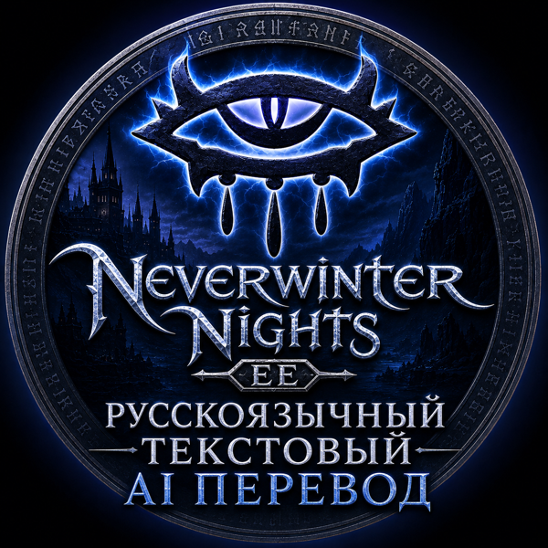

<p align="center">
  
</p>

# NWN:EE — русский AI-перевод

Русский перевод всего текста Neverwinter Nights: Enhanced Edition — основной игры, официальных
кампаний и всех 8 платных премиум-DLC. Только текст, озвучка остаётся английской. Работает на
Windows, Linux и macOS, в Steam и в GOG.

## Как поставить

### Через Steam

Подпишитесь на айтемы **«AI Russian Text …»** в Мастерской Steam — перевод подгрузится сам.

### Без Steam (GOG и другие) — Windows, Linux, macOS

Этот способ переводит **основную игру и официальные кампании**. Нужен установленный Python 3
(на Linux и macOS он обычно уже есть).

1. Скачайте репозиторий: зелёная кнопка **Code → Download ZIP** вверху страницы, распакуйте
   (или `git clone https://github.com/superheher/nwn-ee-russian-ai`).
2. Откройте терминал в этой папке и выполните:
   ```
   python3 install_ru.py
   ```
3. Перезапустите игру.

Скрипт сам находит игру (Steam в любой библиотеке, GOG, на macOS — ещё и через Spotlight). Если
не нашёл — укажите папку: `python3 install_ru.py --game "путь к Neverwinter Nights"`.
Откатить перевод: `python3 install_ru.py --uninstall`.

Перевод DLC без Steam пока ставится только сборкой из исходников (для продвинутых — см.
`PROJECT_KNOWLEDGE.md`).

## Что переведено

Диалоги, журналы и записи заданий, названия и описания предметов, существ и областей, реплики
катсцен, всплывающий и боевой текст, сообщения интерфейса.

Не переведено: озвучка (остаётся английской) и экран выбора кампаний в лаунчере.

---

Технические детали (как устроено, инструменты, сборка из исходников) — `PROJECT_KNOWLEDGE.md`;
по Workshop-айтемам — `WORKSHOP_ITEMS.md`.
